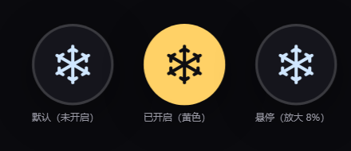

# dsh-snowflake-shutdown ❄️

Shut down Windows after DeepSeek Harness tasks complete — a **desktop-fixed, restyled fork** of
[virggle/dsh-shutdown-after-task](https://github.com/virggle/dsh-shutdown-after-task) (MIT).



## Why this fork exists

The original plugin never showed its button on the **DSH desktop app (Electron)** — no refresh, no restart helped.
Its only UI channel is `webServer.tapIndex`, which injects a `<script>` tag into the **server-rendered** `index.html`.
The desktop shell never renders that page: the host sends **structured injection rows** over IPC instead
(`ctx.webServer.collectIndexInjections()` → `dshDesktopBoot.ready()`), and the page-side interpreter only knows
`global | script | script-src | script-preload | style | html` rows. That table is collected **once at host startup**,
so a `tapIndex` transform is never in the chain.

This fork registers the injection row itself, and tightens the UI while at it.

## Changes over the original

1. **Works on desktop** — also pushes `{ kind: 'script-src', src: '/api/dsh-snowflake-shutdown/ui.js', placement: 'body' }` via `webserver/index-inject`; the original `tapIndex` stays for browser / `dsh web`.
2. **Snowflake circle button** — 32×32 round button with an inline SVG snowflake (follows state colour) instead of a ~150×34 text pill; grows 8% on hover; label moved to the tooltip.
3. **Compact panel** — hugs its text (`width:max-content`, max 320px) instead of a fixed 300px black box, pinned to the bottom-right corner, automatically stacked above the button when they would overlap.
4. **Renamed identity** — package name, `/api/dsh-snowflake-shutdown/*` routes, `~/.dsh/dsh-snowflake-shutdown.log`, `dsh-snow-*` classes, so it can coexist with the original.

Trigger logic, success check, countdown and cancel behaviour are unchanged from the original.

## Install

```sh
dsh plugin --profile desktop add github:eeFrank123/dsh-snowflake-shutdown
```

Then **fully quit DeepSeek Harness (including the tray icon) and reopen it** — the UI script is loaded into the host
process at startup, so a page refresh is not enough.

## Usage

Click the snowflake (turns yellow = armed, default is always off) → run your tasks → when every root session goes idle
the panel shows “任务已完成 / N seconds” → cancel any time with the button, or send a new message to abort just that run.

## Config

```yaml
- id: dsh-snowflake-shutdown
  config:
    countdownSec: 60      # 10–600
    marginSec: 5          # extra shutdown /t margin, 0–60
    onlyOnSuccess: true   # do not shut down if any session errored
```

## FAQ

**Button still missing?** Fully quit the app (including the tray icon) and reopen it — the UI script is loaded when the host process starts, so refreshing the page is not enough.

**`dsh plugin ... add github:...` hangs / `connection to github.com timed out`?** Point git at a local proxy:

```sh
git config --global http.https://github.com.proxy http://127.0.0.1:7897
```

**Want the original back?**

```sh
dsh plugin --profile desktop remove dsh-snowflake-shutdown
dsh plugin --profile desktop add dsh-shutdown-after-task
```

## License

MIT, original copyright notices preserved — see [LICENSE](LICENSE).
